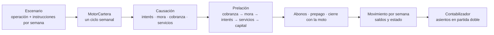

# Motor de reglas de cartera · créditos de moto

Motor de reglas para la plataforma de crédito de motos del proyecto **Financiera** (Juan Esteban Cardozo, Heider Galvis y Diego González). Cada semana del crédito decide qué pasa con el pago del cliente: lo reparte por prelación, causa interés, mora, cobranza y servicios, aplica abonos, prepagos, daciones y retomas, y genera el asiento contable en partida doble.

La fuente de verdad es el Excel de casos operativos de Diego ([`docs/fuentes/`](docs/fuentes/)): el motor reproduce sus 9 casos celda por celda.

**En línea:** [diagrama interactivo](https://juanc101195.github.io/Fintech_Juanes_Heider/diagrama.html) · [cuestionario de reglas para negocio](https://juanc101195.github.io/Fintech_Juanes_Heider/cuestionario.html) · [inicio](https://juanc101195.github.io/Fintech_Juanes_Heider/)

## Estado (16 oct 2026)

- **Los 9 casos del Excel se reproducen celda por celda** (tolerancia 1 COP): operación normal, cambio de tasa, dación en pago, retoma, prepago total, abono extra con menor plazo y con menor cuota, pago inferior con mora y pago tardío con cobranza.
- **147 pruebas automáticas, 0 fallas**, incluidas las reglas que nunca se pueden romper: saldo nunca negativo y asientos siempre cuadrados.
- **Asientos contables** de cada evento en partida doble: recaudo, abonos, pago inferior con reclasificación, cobranza y mora, dación y retoma.
- **Respuestas de Diego del 16 de octubre aplicadas**: pago inicial opcional, abonos y mora antes de dación o retoma (ver abajo).
- **Calidad con Sonar**: [SonarCloud](https://sonarcloud.io/project/overview?id=JuanC101195_Fintech_Juanes_Heider) analiza cada push y cada PR (Java, TypeScript y Python) y GitHub Actions corre las pruebas. Quality Gate aprobado, 0 bugs y 0 vulnerabilidades.
- **Cuestionario para negocio** con solo las 25 preguntas abiertas; las 12 que Diego ya respondió quedan a la vista como respondidas.

## Cómo funciona el motor



Cada caso del Excel es un `Escenario` con instrucciones por semana: pago completo, parcial, tardío, sin pago, abono, prepago, cambio de tasa, dación o retoma. Un solo ciclo los cubre todos.

## Reglas de negocio

Lo que el Excel no define se configura en `ReglasNegocio`. Por defecto reproduce el Excel; las respuestas de negocio se cargan desde [`config/reglas-negocio.properties`](config/reglas-negocio.properties).

| Regla | Decisión | Fuente |
|---|---|---|
| Pago inicial | Opcional: lo digita el asesor y se resta del valor total de la operación | Diego, P-09 |
| Abono extra sin elección del cliente | Reduce el plazo | Diego, P-13 |
| Abono mayor que el saldo | Se rechaza | Diego, P-14 |
| Mora antes de dación o retoma | Se causa como en cualquier atraso | Diego, P-16 |
| Interés sobre capital vencido | El vencido paga solo mora | Diego, P-03 |
| Fondo de garantías y seguro | Sobre el monto financiado inicial | Diego, P-07 |
| Redondeo | Ninguno en el cálculo; solo en la presentación | Diego, P-05 |

Detalle de cada respuesta y lo que falta: [docs/respuestas-diego-2026-10-16.md](docs/respuestas-diego-2026-10-16.md). Historial de decisiones: [docs/decisiones.md](docs/decisiones.md).

## Estructura

| Carpeta | Contenido |
|---|---|
| [`src/`](src/) | Motor (Java 21, Spring Boot 4, monolito modular con Spring Modulith) y sus pruebas |
| [`cuestionario/`](cuestionario/) | Página para que negocio responda las reglas abiertas viendo el efecto calculado de cada opción; exporta las respuestas a Excel |
| [`herramientas/`](herramientas/) | Exportador del Excel a CSV de prueba e importador de las respuestas del cuestionario |
| [`config/`](config/) | Reglas de negocio vigentes |
| [`docs/`](docs/) | Decisiones, ADR, reglas por caso, preguntas y respuestas de negocio, pendientes y diagrama |
| [`backlog-financiera/`](backlog-financiera/) | Épicas, features e historias (Gherkin) del proyecto y su priorización por sprints |

## Cómo correrlo

Requisitos: JDK 21, Node 20+ y Python 3.

```bash
# Motor
export JAVA_HOME="/c/Program Files/Microsoft/jdk-21.0.10.7-hotspot"
./mvnw -q -B test                              # 147 pruebas
python herramientas/exportar_excel.py          # regenera los CSV de prueba desde el Excel

# Cuestionario para negocio
cd cuestionario && npm install
npm run escenarios   # calcula con el motor las cifras de cada opción
npm run dev          # lo abre en el navegador
npm run build        # dist/index.html: un solo archivo para enviar por correo

# Análisis de calidad local (SonarQube en Docker)
docker run -d --name sonarqube-motor -p 9000:9000 sonarqube:community
(cd cuestionario && npm run cobertura)
./mvnw -B verify org.sonarsource.scanner.maven:sonar-maven-plugin:sonar   -Dsonar.host.url=http://localhost:9000 -Dsonar.token=<token> -Dsonar.organization= -Dsonar.projectKey=motor-cartera

# Respuestas de negocio → motor
python herramientas/importar_respuestas.py <excel-de-respuestas>.xlsx
./mvnw -q -B test    # ReglasNegocioConfiguradaTest corre los casos con esas reglas
```

## Cómo se construyó

Una sesión orquestadora armó el núcleo y el caso 1. Después, 9 agentes de IA en paralelo, uno por caso del Excel y cada uno en su propia rama, reprodujeron los demás. La integración unió sus 9 entregas y el cuestionario llevó las preguntas a negocio. Con las respuestas de Diego llegaron las reglas del 16 de octubre.

**[Abrir el diagrama interactivo →](https://juanc101195.github.io/Fintech_Juanes_Heider/diagrama.html)** (tema claro u oscuro, modo presentación, exportar, ruta entre nodos y búsqueda)

Prompts, métricas por agente y método: [docs/agentes/](docs/agentes/README.md). El sitio se publica solo desde `main` con [`.github/workflows/sitio.yml`](.github/workflows/sitio.yml).

## Documentos clave

- [Decisiones](docs/decisiones.md) y [ADR del monolito modular](docs/adr/0001-monolito-modular.md)
- [Preguntas para Diego](docs/preguntas-diego.md) y [sus respuestas del 16 de octubre](docs/respuestas-diego-2026-10-16.md)
- Reglas por caso: [`docs/reglas/caso-1.md`](docs/reglas/caso-1.md) a [`caso-9.md`](docs/reglas/caso-9.md)
- [Pendientes técnicos](docs/pendientes-tecnicos.md)
- [Backlog y priorización](backlog-financiera/)
